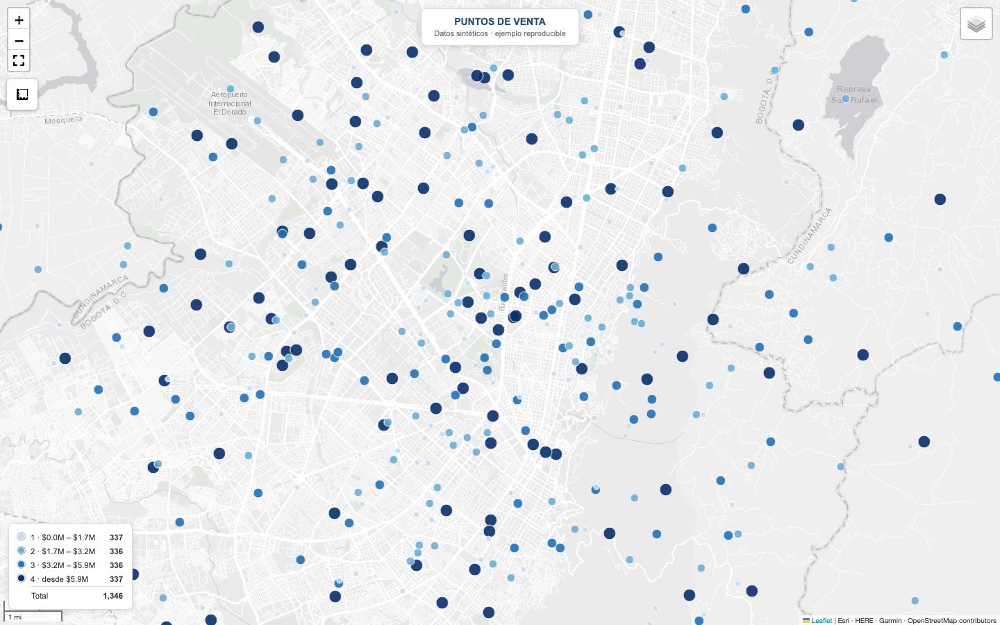
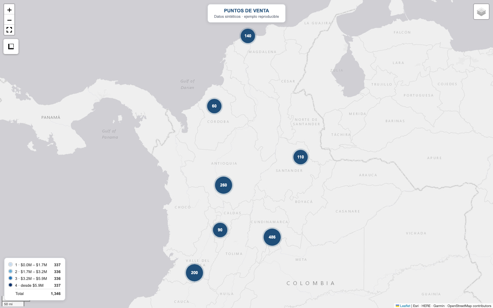

# Mapas ejecutivos de Colombia

[](https://github.com/s-osorio-gom/mapas-ejecutivos-colombia/actions/workflows/pruebas.yml)

Librería para producir mapas de puntos **presentables a un comité**, en un solo
archivo HTML que abre con doble clic y se manda por correo. Folium sobre
cartografía oficial del DANE, escala secuencial de un tono, leyenda con
conteos, y una validación que compara el HTML contra la base que lo originó.



<sub>Salida del ejemplo, sobre datos sintéticos. El color y el tamaño dicen lo
mismo —cuánto vende el punto— y por eso se lee sin consultar la leyenda.</sub>

## Correrlo

Requiere Python 3.10 o superior.

```bash
python3 -m venv .venv
source .venv/bin/activate            # Windows: .venv\Scripts\activate
pip install -e .                     # librería: pandas, numpy, folium
python ejemplo/demo.py
open ejemplo/salida/mapa_nacional.html   # Linux: xdg-open · Windows: start
```

`pip install -r requirements.txt` también sirve: instala lo mismo más
geopandas, y el ejemplo corre desde la raíz del repositorio sin instalar el
paquete.

El ejemplo funciona sin descargar cartografía: la capa territorial es opcional.
Con ella hace falta geopandas:

```bash
pip install -e ".[territorial]"
python ejemplo/demo.py --shp ruta/MGN_ADM_DPTO_POLITICO.shp
```

El HTML lleva los datos adentro, pero **necesita internet al abrirse**: Leaflet
y sus complementos se cargan de CDN públicos y el fondo, de los servidores de
Esri. Sin conexión no se pinta.

### Pruebas

```bash
pip install -e ".[territorial,dev]"
ruff check .
pytest -q
python ejemplo/demo.py               # termina con «0 fallos» o sale con código 1
```

Las pruebas no usan red ni la cartografía del DANE: la capa territorial se
prueba sobre un shapefile ficticio que generan ellas mismas. Es lo mismo que
corre el workflow de GitHub Actions.

La revisión en navegador es aparte, porque necesita Playwright y Chromium:

```bash
pip install playwright && playwright install chromium
python ejemplo/qa_visual.py          # deja capturas en ejemplo/salida/qa_*.png
```

## Usarlo

```python
from mapa_ejecutivo import MapaEjecutivo, por_cuantiles
from mapa_ejecutivo.preparar import validar_coordenadas
from mapa_ejecutivo.validar import verificar

limpio, informe = validar_coordenadas(df, "lat", "lon")

m = MapaEjecutivo(limpio, lat="lat", lon="lon", valor="venta_mes",
                  nombre="cliente", titulo="PUNTOS DE VENTA",
                  subtitulo="Enero 2026",
                  popup=[("Ciudad", "ciudad"), ("Venta del mes", "venta_mes")])
m.capa_departamentos("MGN_ADM_DPTO_POLITICO.shp")     # opcional
ruta = m.guardar("mapa.html")

verificar(ruta, limpio, valor="venta_mes", rangos=m.rangos, nombre="cliente")
```

Los rangos se calculan por cuartil si no se pasan. Si el negocio ya tiene sus
cortes, se pasan explícitos con `Rango(...)`. Con muchos valores repetidos, los
cuantiles que coinciden se fusionan: salen menos rangos, nunca uno vacío.

`MapaEjecutivo` rechaza con un mensaje claro las columnas que no existen, el
DataFrame vacío, las coordenadas nulas o imposibles y los colores que no son
hexadecimales. Los textos de la base —nombres, valores, etiquetas, título— se
escapan antes de entrar al HTML, de modo que un nombre con `<`, comillas o
`${...}` se muestra tal cual y no se ejecuta.

Al cargar una capa territorial, el rótulo del mapa cita la fuente
(«Límites: DANE, Marco Geoestadístico Nacional»); con `atribucion=` se cambia si
la capa es de otra fuente.

## Tres cosas que esta librería hace y un script suelto no

**Valida las coordenadas antes de dibujar.** La mitad de los mapas que salen mal
no tienen un problema de mapa: tienen un problema de base.

```
  Coordenadas
      filas                           1,350
    ⚠ sin coordenada                      1
    ⚠ en cero                             1
    ⚠ fuera del area                      3
    ⚠ posible lat lon invertida           2
      utilizables                     1,346
      → revise si esas filas traen latitud y longitud al revés
```

`(0, 0)` casi nunca significa el Golfo de Guinea: significa "no sé dónde queda".
Y la **latitud y longitud invertidas** es el error más difícil de ver, porque
los puntos sí aparecen en el mapa — en otro continente.

**Compara el HTML contra la base.** Un mapa puede verse perfecto y estar
mostrando otra cosa:

```
  [OK  ] un marcador por fila — 1,346 en el HTML · 1,346 en la base
  [OK  ] rango «1 · $0.0M – $1.7M» — 337 pintados · 337 esperados
  [OK  ] rango «4 · desde $5.9M» — 337 pintados · 337 esperados
  [OK  ] el registro más grande aparece — Cliente 1154
  [OK  ] pesa menos de 5 MB — 2.6 MB
```

**Simplifica la geometría.** El MGN del DANE sin simplificar produce HTML de más
de 40 MB, que no se manda por correo y arrastra un detalle que a escala nacional
no se ve. Con la simplificación por defecto, el mismo mapa pesa unos 3 MB.

## El fondo del mapa ya no es el de siempre

CartoDB Positron era el fondo estándar para esto. **Pasó a exigir clave de API:**
sin ella devuelve teselas estampadas con «API KEY REQUIRED» sobre todo el mapa,
y no produce ni un error en la consola del navegador. Un mapa que parece roto,
con todos los chequeos automáticos en verde.

Esta librería usa el gris claro de Esri, que no pide clave. Se descubrió mirando
una captura de pantalla, que es también la última regla de
[`docs/reglas-visuales.md`](docs/reglas-visuales.md): antes de mandar el mapa,
ábralo y mírelo.

## Reglas visuales

Nueve, todas con su razón, en [`docs/reglas-visuales.md`](docs/reglas-visuales.md).
Las tres que más cambian el resultado:

- **Escala de un solo tono** para las magnitudes. Los colores distintos se
  reservan para lo que no tiene orden: región, dueño, canal.
- **Los puntos grandes se dibujan encima.** Si no, el cliente pequeño tapa al
  estratégico, que es el que se fue a buscar al mapa.
- **Cortes por cuantil, no a ojo.** Los cortes redondos elegidos pensando en los
  clientes grandes producen un mapa de un solo color y tres puntos oscuros.

Sobre la cartografía —de dónde bajarla, qué capas, cómo simplificarla— en
[`docs/cartografia-dane.md`](docs/cartografia-dane.md).



<sub>Vista nacional del mismo ejemplo: con más de 600 puntos se agrupan en
racimos del tono de la marca, que se abren al acercarse.</sub>

## Qué NO hace

- **No trae la cartografía.** Pesa más de 1 GB, se actualiza cada año y tiene su
  propia licencia. Se baja del [geoportal del DANE](https://geoportal.dane.gov.co/).
- **No funciona sin conexión.** Las librerías del mapa y el fondo vienen de
  internet.
- **No hace mapas de coropletas.** Está pensada para puntos.
- **No es un tablero.** Si necesita filtros encadenados y consultas en vivo, esto
  no alcanza: Streamlit o Dash.
- **No sirve para datos confidenciales publicados.** El HTML lleva los datos
  adentro. Mandarlo por correo es una cosa; subirlo a GitHub Pages es otra.

---

### In English

A library for executive-grade point maps of Colombia: single-file interactive
HTML, official DANE cartography, single-hue sequential scales, legend with
counts, coordinate validation (nulls, zeros, swapped lat/lon), HTML-escaped
popups, and a validator that checks the rendered HTML against the source
dataframe. Runs without the cartography — that layer is optional. Install with
`pip install -e .`; tests with `pytest`. Docs in Spanish.

## Licencia

MIT — ver [LICENSE](LICENSE).
